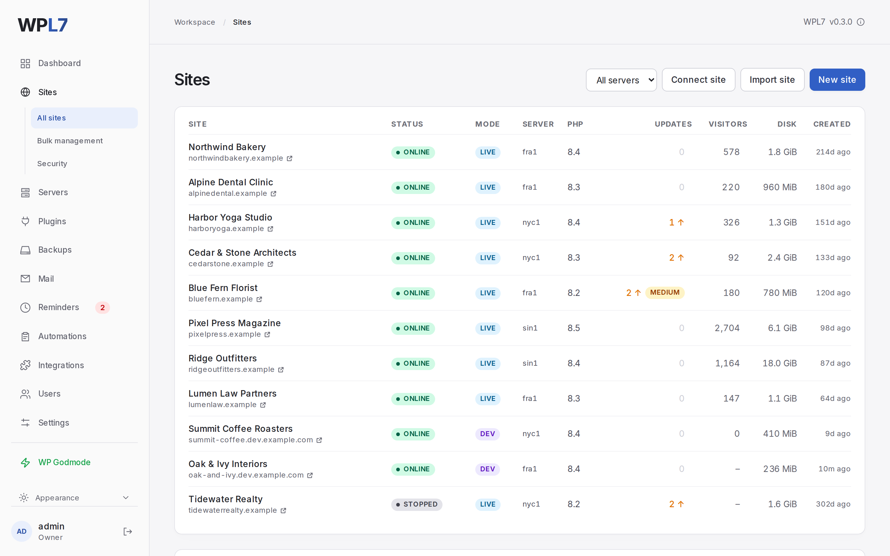
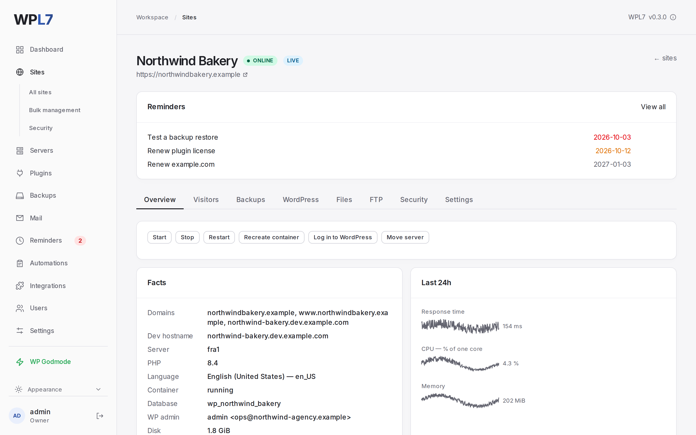
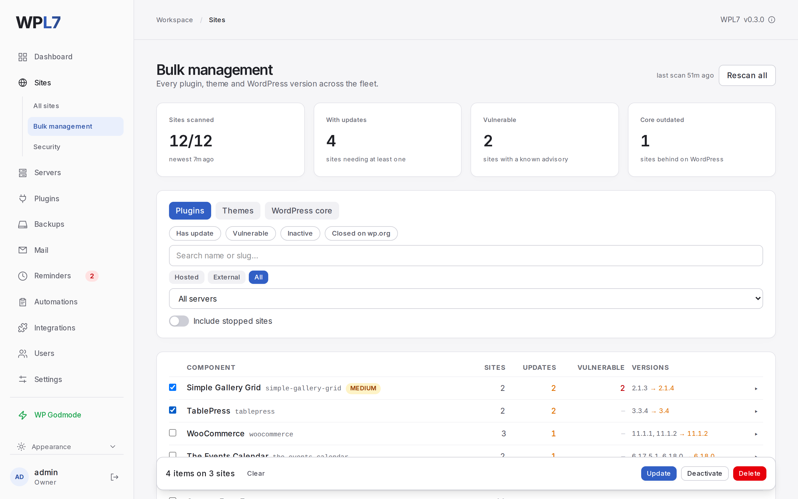
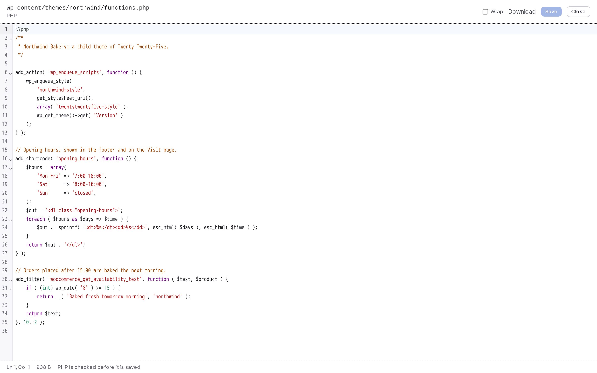
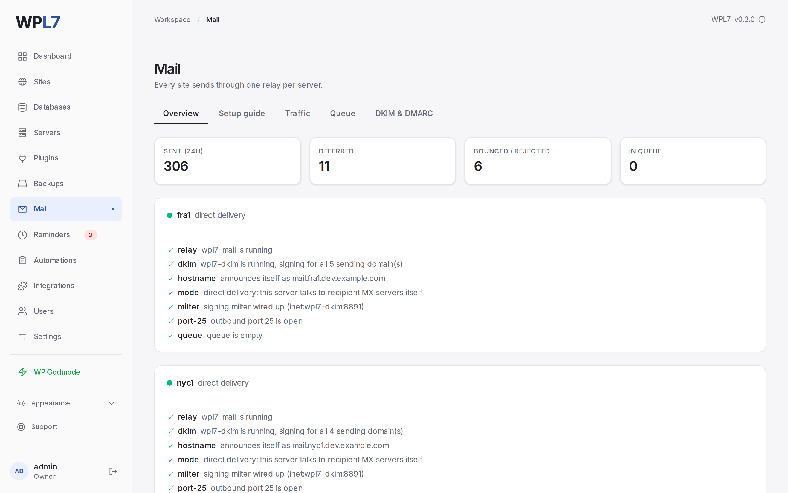

# WPL7

**Turn your VPS into a self-hosted WordPress powerhouse.** Host and run WordPress websites,
with simple go live, automated backups, emailing, web FTP, auto DNS, installation recipes,
advanced security, malware scanner, plugin updates, vulnerability alerts, bulk management, MCP
and more.

[](https://github.com/andyfo/wpl7/actions/workflows/deploy.yml)
[](https://github.com/andyfo/wpl7/releases)
[](LICENSE)

**[wpl7.com](https://wpl7.com)** · [Documentation](https://wpl7.com/docs/) ·
[Quick start](#quick-start)



WPL7 turns a plain Ubuntu server into WordPress hosting: every site in its own container with
its own PHP version, certificates, working mail, backups and a REST API. It is for agencies and
freelancers hosting their clients' sites, and for anyone who would rather pay for a server than
per site. The panel runs on your server, with no control plane and no telemetry.

## Features

Listed the way the panel's menu is.

| | |
|---|---|
| **Dashboard** | Servers, recent activity and WordPress versions at a glance. |
| **[Sites](https://wpl7.com/docs/sites/overview/)** | One container per site, PHP 8.2–8.5, automatic HTTPS. A new site is live on its dev address in seconds; **Go live** moves it to the customer's domain without downtime. One-click `wp-admin` login, Web FTP in the browser, FTP/SFTP logins per site, visitor statistics without cookies, import from another host, and sites hosted elsewhere through a connector plugin. |
| ↳ **Bulk management** | Every plugin, theme and WordPress version across all sites, rated against known vulnerabilities, updated as one batch with an optional backup first. |
| ↳ **Security** | Per-site rules and login/request limits, an attacker blocked on every server at once, and a daily malware scan against wordpress.org's checksums with quarantine. |
| **[Servers](https://wpl7.com/docs/servers/overview/)** | Add a blank server and the panel sets it up over SSH. Uptime, CPU, RAM and disk, a browser terminal, and moving sites between servers. |
| **[Plugins](https://wpl7.com/docs/plugins/overview/)** | The catalog new sites start from (wordpress.org plugins and your premium zips), and **recipes** that activate pro-plugin licenses (ACF PRO, Breakdance, …) on every new site. |
| **[Backups](https://wpl7.com/docs/backups/overview/)** | Scheduled and on-demand backups, restore and download, a storage location per server, and encrypted offsite copies to S3, SFTP, FTP or WebDAV. |
| **[Mail](https://wpl7.com/docs/mail/overview/)** | `wp_mail()` works out of the box: a DKIM-signing relay, per-site credentials, every message and the queue, and a guide that checks SPF/DKIM/DMARC against live DNS. |
| **[Reminders](https://wpl7.com/docs/automations/reminders/)** | Domain renewals, PHP and OS end-of-life dates, and your own one-time or recurring reminders. |
| **[Automations](https://wpl7.com/docs/automations/jobs/)** | Every change runs as a job with a log; schedules run backups, scans and your own WP-CLI or shell commands. |
| **[Integrations](https://wpl7.com/docs/integrations/api/)** | A REST API with keys at three levels, and an MCP server so Claude, ChatGPT, Cursor and others can work in the panel. |
| **[Users](https://wpl7.com/docs/panel/users/)** | An account for every admin, with optional two-factor authentication. |
| **[Settings](https://wpl7.com/docs/panel/settings/)** | Site defaults, DNS through Cloudflare, mail, backups, monitoring, and self-updates with a health check and automatic rollback. |

<table>
  <tr>
    <td></td>
    <td></td>
  </tr>
  <tr>
    <td></td>
    <td></td>
  </tr>
</table>

## Quick start

You need a fresh **Ubuntu 26.04 x86-64** server (2 GB RAM or more) with root access and ports
80 and 443 open, and a domain whose DNS you can edit. WPL7 takes the whole machine: it installs
Docker and enables a firewall.

**1. DNS.** Create both records and wait until they resolve:

| Record | Name | Value |
|---|---|---|
| A | `panel.example.com` | your server's IP |
| A | `*.dev.example.com` | your server's IP |

**2. Install.**

```bash
curl -fsSL https://github.com/andyfo/wpl7/releases/latest/download/install.sh | sudo bash -s -- \
  --panel-domain=panel.example.com \
  --dev-domain=dev.example.com \
  --acme-email=you@example.com
```

**3. Sign in** at `https://panel.example.com` as `admin`, with the generated password:

```bash
sudo docker logs wpl7-panel | grep -A2 'First boot'
```

**4. Before real customer traffic**, set `SMTP_RELAYHOST` in `/opt/wpl7/deploy/.env` and apply
it with `sudo /opt/wpl7/provision/setup.sh`, and add a Cloudflare API token under
**Settings → DNS**.

The [installation guide](https://wpl7.com/docs/get-started/installation/) has every flag and
how to read the script before running it.

**Updating:** the panel tells you when there is a new version; **Settings → Updates → Update**
applies it, and rolls back if the new one does not come back healthy
([docs](https://wpl7.com/docs/panel/updating/)).

## How it works

```
                       ┌──────────── your server ────────────┐
    :80 :443 ──────────┤ Traefik  ── TLS, routing, access log │
                       │    │                                 │
                       │    ├── wp-alpha   (PHP 8.3)  ──┐     │
                       │    ├── wp-beta    (PHP 8.4)  ──┤ one network each
                       │    └── wp-gamma   (PHP 8.2)  ──┘     │
                       │            │            │            │
                       │         MariaDB      postfix + DKIM   │
                       │                                      │
                       │  panel  ── Node + SQLite, /srv, docker.sock
                       └──────────────────────────────────────┘
```

The panel is one Node process with a SQLite database. Sites are containers it creates through
the Docker API, and Traefik finds them by label. A site shares a network only with Traefik,
MariaDB and the mail relay, never with another site. Long operations run as jobs with logs and
rollbacks. More in [How WPL7 works](https://wpl7.com/docs/get-started/how-it-works/).

On its own the panel only fetches public data (new versions, vulnerability advisories,
checksums, address lists); [What leaves your server](https://wpl7.com/docs/security/privacy/)
lists every call.

## Documentation

The full documentation is at **[wpl7.com/docs](https://wpl7.com/docs/)**. Notes for working on
WPL7 itself are in [docs/development.md](docs/development.md) and
[docs/local-dev.md](docs/local-dev.md).

## Security

The panel holds the Docker socket and an SSH key for root on its servers: **it is
root-equivalent by design**. Protect its accounts and API keys like a root shell.

What it contains is a compromised *site*, the thing that actually happens to self-hosted
WordPress. [docs/operations.md](docs/operations.md#security-posture) describes the blast radius,
including what is not contained.

Found a vulnerability? [Report it privately](https://github.com/andyfo/wpl7/security/advisories/new)
(see [SECURITY.md](SECURITY.md)).

## Status

**Beta (0.x).** It hosts real sites, and every merge runs on the maintainer's own server before
it becomes a release. The API and the `.env` keys may still change between minor versions, and
only the newest release is supported. Take a backup before you update, and read the release
notes.

## Contributing

See [CONTRIBUTING.md](CONTRIBUTING.md). Open an issue before writing a feature; bug fixes can go
straight to a pull request. A contributor licence agreement is required before a first PR is
merged.

## License

[AGPL-3.0-only](LICENSE), in plain English:

- You can run WPL7 for yourself, your company or your clients, modify it however you like, and
  keep those modifications to yourself.
- The obligation to publish your changes is triggered by **offering your modified version to
  other people as a service**. Hosting *websites* for customers is using WPL7, not offering it,
  and triggers nothing.
- If you do distribute it or offer it as a service, the source has to go with it, under the
  same licence.

The name and logo are not covered by that licence: see [TRADEMARK.md](TRADEMARK.md).

Malware scans run [AMWScan](https://github.com/marcocesarato/PHP-Antimalware-Scanner) by Marco
Cesarato, which is GPL-3.0 and not part of WPL7: each server pulls its official image, pinned by
digest, and runs it unmodified as a separate process
([docs/security.md](docs/security.md#amwscan)).

The panel ships two third-party assets. The [Inter](https://rsms.me/inter/) typeface is under
the SIL Open Font License 1.1 (`panel/web/src/fonts/LICENSE.txt`). The
[WP Godmode](https://wpgodmode.com) logo and screenshots on the panel's WP Godmode page
(`panel/web/src/components/Godmode.tsx`, `panel/web/src/assets/wpgodmode/`) belong to WP Godmode
and are not covered by the AGPL.
